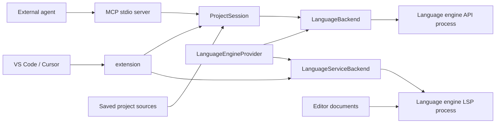

# Product architecture

**English** | [简体中文](architecture.zh-Hans.md)

Systrace is a VS Code/Cursor extension with read-only MCP tools for external agents:
`validate`, `find_element`, `describe_element` and `library_lookup`. The language engine owns parsing, name resolution and semantic checks.

`config/engine.json` records the tested engine version and source revision. Updating
the engine repository does not automatically update the product. The engine interface
is separate from that version: interface version 1 describes how Systrace connects to
an implementation, not which SysML release or engine capabilities it implements.

## Component responsibilities

The engine provider selects the model backend and language-service description
together. `ProjectSession` owns saved-file snapshots, project revisions, request
serialization and pagination. `LanguageBackend` supplies validation evidence and
model queries. The extension uses standard LSP for editor features and a
`LanguageServiceBackend` description for process startup, version checks and the
engine's standard-library document protocol.

Engine-specific framing, RPC schemas, diagnostic mapping and native queries live in
implementations under `packages/engine-adapter/src/backends`. Product callers use
the language-engine interface rather than invoking native RPCs directly. The four MCP tool schemas and
current result behavior are retained. Query kinds and diagnostic raw details may
remain provider-specific; the interface does not invent a universal semantic taxonomy.

The provider connects the editor and model tools
to the selected language engine; there is no automatic engine fallback or user-facing engine
selector. The [language-engine interface](language-engine-interface.md) documents
the implemented boundary.

## Projects and processes

Each project root uses a separate LSP client. Its own source folders and declared
project dependencies are sent to the same engine session for cross-file resolution.
The shared `.systrace/project.json` records relative source folders and references.
The adapter loads transitive references once, rejects missing, overlapping or cyclic
project configurations, and uses the same closure for saved validation and MCP queries.
The editor sends unsaved documents only to their owning project. Dependency tabs use
a separate read-only URI scheme and saved content; their LSP URIs map back to the
original files. Saving a dependency updates consumers even when that project is closed.
Changing the dependency graph reconnects affected LSP clients. The current provider
uses the same configured engine version for LSP and API; they manage separate
processes and model state. Matching configuration is not an independent certification
of standard-library identity. LSP can include unsaved editor content; MCP reads saved
files. Their results must not be represented as observations of an identical snapshot.

Engine-specific environment overrides are removed from the language engine child processes.
This version does not support replacing the standard library or loading external
analysis tools through environment variables.

The language engine provides standard-library locations and source content through
its service description. The extension's read-only document provider checks the
advertised capability, requests the content and gives each project its own editor
URI scheme. Native request names and URI formats stay inside the backend. The language client
converts LSP messages back to the engine's original URIs, leaving library hover and
navigation to the engine. A random project identifier persists in workspace state
across restarts; library URIs do not contain project paths. Reconnection refreshes
open library documents. Reads support cancellation and the configured timeout;
delayed responses from an old connection are not presented as new content.

The backend handles the language engine's native transport and checks the configured
version and required capabilities before submitting the model's file contents. Requests are serialized per project, with a queue limit of 8 and a
default timeout of 30 seconds. A timeout or cancellation disposes of the process.
At most one automatic reconnection is allowed; after that, a new session is required.
Failed requests are not automatically retried or disguised as validation results.

Model files are read as UTF-8. Paths must remain inside their owning project, and symlinks or
junctions in model directories are rejected. Hidden directories and `node_modules`
are excluded from scanning. Source roots default to the project folder. Ordinary directory names such as
`designs` are permitted; configure source folders when generated models should be excluded. Limits are 2,000 files, 2 MiB per
file, 32 MiB across the dependency closure and 4,000 directories per project. These are product resource limits, not
language restrictions or semantic acceptance criteria.

## Saved snapshots and results

A session has a random `sessionId`. Changes to file content, names, source roots or project references
increment `projectRevision`. A request retains immutable input bytes and rereads
the files after the engine responds; concurrent changes invalidate the result.
Validation pages and filtered scopes share a revision, and edits invalidate old
cursors. Model handles belong to their creating backend and process generation;
raw native model identifiers stay behind that boundary. Query identities are not
promised to survive edits, renames, restarts or engine replacement. The product does
not generate file-digest inventories for users.

`validate` always checks the complete saved project and its declared references; `paths` only filters the display.
Results include project-wide and filtered error/warning totals, original diagnostic
messages, native codes, locations, categories and pagination cursors. Unknown
categories remain `UNCLASSIFIED`. The backend applies its existing mapping
from native codes and, where configured, diagnostic message patterns.

`errors` takes precedence over `incomplete`. This version lacks evidence for returning
`clean`: the native API supplies diagnostics but no completeness proof or independently
verifiable standard-library version. All three `completeness` fields explicitly remain
`unknown`. Absence of diagnostics does not establish complete checking. Partial query
results state their limitations. Language checks, task assertions and engineering
correctness are different claims.

## Configuration and privacy

`config.example.js` is the generic template. Developers put local configuration in
the ignored `config.js`. Development and test scripts read engine and editor locations
from it. Installed extension settings are managed by the editor, and the MCP CLI uses
startup arguments. Both read the shared project configuration when present;
`dryas.modelRoots` and `--model-root` remain fallbacks for projects without it. Neither executes an arbitrary `config.js` from a model project.

Private personal information, absolute machine paths, device identifiers, time zones,
credentials and raw execution logs stay out of product source and documentation.
Public GitHub identities may be used for commit attribution. Content checks report
only matching files and rules, without echoing sensitive values. Packaging uses a
file allowlist.

## Current boundaries

There is no graphical editing, view rendering, built-in agent, database, self-developed
SysML parser or execution/simulation API. Native standards conformance, general
interactive performance and release readiness still require validation; small examples
and development-host tests do not establish them. Mock backends verify contract and
session behavior; they do not establish native language correctness.

References: [VS Code LSP guide](https://code.visualstudio.com/api/language-extensions/language-server-extension-guide),
[extension testing guide](https://code.visualstudio.com/api/working-with-extensions/testing-extension),
[MCP TypeScript SDK](https://github.com/modelcontextprotocol/typescript-sdk).

The current selection is listed in [Language engine](language-engine.md).
