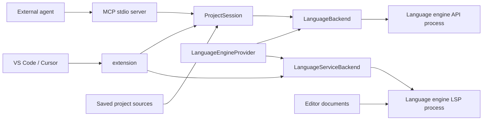

# 产品架构

[English](architecture.md) | **简体中文**

Systrace 是 VS Code/Cursor 扩展，并向外部 agent 提供只读 MCP 工具：
`validate`、`find_element`、`describe_element`、`library_lookup`。
language engine（语言引擎）负责解析、名称解析和语义检查。

`config/engine.json` 记录经过测试的引擎版本和源码提交；更新引擎仓库不会自动升级产品。
引擎接口版本与其分开：接口版本 1 描述 Systrace 如何连接实现，不代表它实现了哪个 SysML
版本或具备哪些语义能力。

## 组件职责

引擎提供者同时选择模型后端和语言服务描述。`ProjectSession` 负责保存文件快照、项目修订、
请求串行化和分页；`LanguageBackend` 提供验证证据与模型查询。
扩展使用标准 LSP 提供编辑器功能，再通过 `LanguageServiceBackend` 描述完成进程启动、
版本检查和引擎标准库文档协议的接入。

引擎专用的通信格式、RPC 数据结构、诊断映射和原生查询集中在
`packages/engine-adapter/src/backends` 下的后端实现中。
产品调用方使用语言引擎接口，不直接发送原生 RPC。四个 MCP 工具的输入格式和现有返回行为保持不变。
查询 kind 和诊断原始详情可能仍由后端定义；该接口不虚构统一的语义类别体系。

引擎提供者将编辑器和模型工具接到所选语言引擎；没有自动引擎回退或用户可见的引擎选择器。
已实现的接口边界见[语言引擎接口](language-engine-interface.zh-Hans.md)。

## 项目与进程

每个编辑器工作区使用独立 LSP 客户端，多个模型源码根送入同一个工作区引擎，保留跨文件解析能力。
当前提供者为 LSP 和 API 使用相同配置的引擎版本；两者分别管理进程和模型状态。
配置一致不等于标准库身份已获得独立认证。LSP 可包含未保存编辑，MCP 读取保存文件，不能把
两者的结果表述为同一快照的观察结果。

语言引擎子进程会清除引擎专用环境覆盖；当前不支持用环境变量替换标准库或加载外部分析工具。

语言引擎通过服务描述提供标准库位置和源码。扩展的只读文档提供器核对声明的能力、请求内容，
并为每个项目设置独立的编辑器 URI scheme。原生请求名称与 URI 格式留在后端实现内部。语言客户端在 LSP 消息边界转换回引擎原始 URI，库内悬浮和跳转仍由引擎处理。
项目随机标识保存在工作区状态中并跨重启复用；标准库 URI 不包含项目路径。
重连刷新已打开的库文档；读取支持取消与配置超时，旧连接的延迟响应不会当作新内容展示。

后端负责语言引擎的原生通信，先核对配置版本和所需能力，再提交
模型文件内容。每个项目串行处理，队列上限 8，请求默认超时 30 秒。超时或取消回收进程，最多自动
重新建立一次连接，随后需要新会话。失败请求不自动重做，也不伪装成验证结果。

模型文件按 UTF-8 读取；路径限于项目内，模型目录中的符号链接和 junction 被拒绝。
默认源码范围为项目根目录；`designs` 等普通目录可包含模型，可用 `dryas.modelRoots` 缩小范围。
隐藏目录和 `node_modules` 不参与扫描。上限为 2,000 个文件、单文件 2 MiB、总计 32 MiB 和 4,000 个目录。
这些是产品资源限制，不是语言限制或语义验收门槛。

## 保存快照与结果

每次会话具有随机 `sessionId`；文件内容、名称或源码根变化时增加 `projectRevision`。
请求保留不可变输入字节，并在引擎响应后重读文件比较；并发修改会使结果失效。
验证页和过滤范围属于同一修订，编辑使旧游标失效。模型句柄属于创建它的后端及进程代数，原生模型
标识留在后端内部；不承诺查询 ID 在编辑、重命名、重启或替换引擎后稳定。产品不生成用户文件摘要清单。

`validate` 始终检查整个保存项目，`paths` 只过滤显示。结果包括项目及筛选范围的错误/警告总数、
诊断原文、原生代码、位置、类别与分页游标。未知类别保留为 `UNCLASSIFIED`。
后端继续使用现有映射，根据原生代码及已配置的消息模式确定类别。

`errors` 优先于 `incomplete`。当前没有返回 `clean` 的证据：原生 API 提供诊断，但没有完整性证明
或可独立核对的标准库版本。三项 `completeness` 仍明确为 `unknown`；缺少诊断不能证明检查完整。
部分查询结果说明自身限制。语言检查、任务断言和工程正确性是不同层次。

## 配置与隐私

`config.example.js` 提供通用模板；开发者在不跟踪的 `config.js` 填写本地配置，开发和测试脚本
从中读取引擎及编辑器位置。安装后的扩展设置由编辑器管理，MCP CLI 使用启动参数；两者都不会
执行模型项目中的任意 `config.js`。

非公开个人信息、本机绝对路径、设备标识、时区、凭据和原始日志不进入产品源码与文档。
公开 GitHub 身份可以用于提交署名。内容检查只报告命中的文件和规则，不回显敏感值。打包使用文件白名单。

## 当前边界

当前没有图形编辑、view 渲染、自有 agent、数据库、自研 SysML 解析器或执行/仿真 API。
原生标准一致性、通用交互性能和发布条件仍需验证；小型示例和开发宿主测试不能替代这些结论。
mock 后端只检验接口与会话行为，不能证明原生语言实现的正确性。

参考：[VS Code LSP 指南](https://code.visualstudio.com/api/language-extensions/language-server-extension-guide)、
[扩展测试指南](https://code.visualstudio.com/api/working-with-extensions/testing-extension)、
[MCP TypeScript SDK](https://github.com/modelcontextprotocol/typescript-sdk)。

当前引擎选择见 [Language engine](language-engine.zh-Hans.md)。
